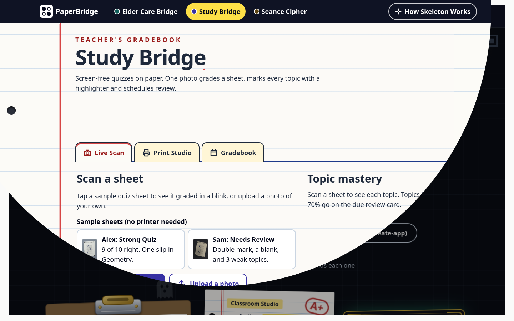
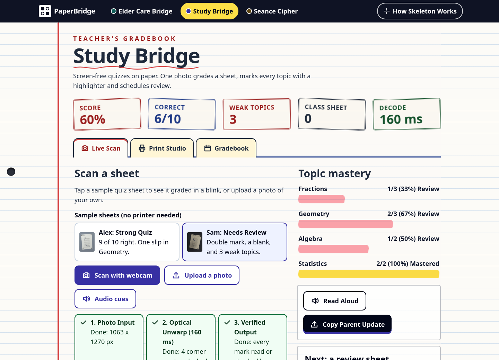
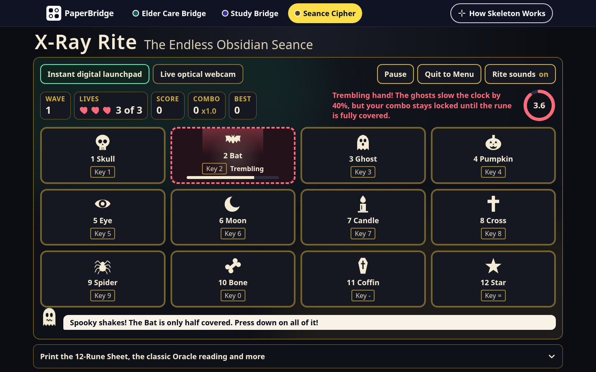
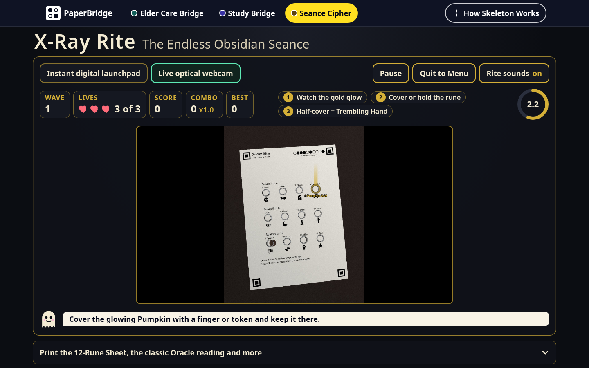
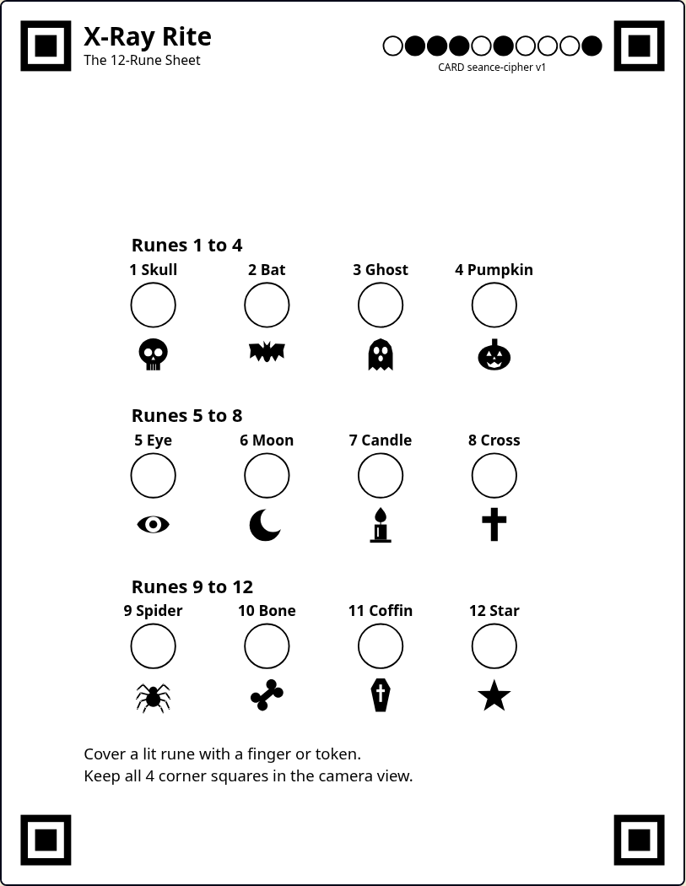

# PaperBridge

**Resurrecting reliable paper forms as an offline-first optical UI skeleton - zero AI guessing.**

Print a card, fill it in with a pen, take one photo. One shared optical engine reads it on your device with corner
markers and a perspective unwarp, sends anything unclear to a person, and powers three very different full-screen
apps plus a Kiro Crew App. Built for **Kiroween 2026: Skeleton Crew**.

## The 60-second version

- **The problem.** Paper forms still run clinics, classrooms and care at home. Apps that scan them either guess with AI or need special hardware.
- **What it does.** Print a card, mark it with a pen, take one photo. PaperBridge finds the 4 corner squares, flattens the photo, and reads each bubble on your own device. No account, no upload, no extra hardware: a phone or webcam and a printer (or a sample card) is enough.
- **Why it is not AI.** The reader is plain geometry and pixel counts, so the same photo always gives the same answer. A mark it cannot judge is shown to a person, who taps Mark filled or Mark blank. Nothing is guessed.
- **What surprised us.** Letter prints were being read as A4 until a 50-photo test caught it. A pale fingertip reads only 0.30 to 0.45 as "covered", which became the Trembling Hand rule in the game. A first-time audit then showed that Elder Care and Study Bridge said nothing in words when a photo had no card in it (see [DETAILS](docs/DETAILS.md#first-time-user-audit-phase-13)).
- **Kiro surfaces used.** Specs, steering, agent hooks, an MCP server, a scaffolder and a Kiro Crew App (table below).

<!-- Demo video row, hidden until the video is uploaded. Paste it back into the table below the Live demo row:
| **Demo video** | [Watch on YouTube](https://www.youtube.com/watch?v=VIDEO_ID) |
-->
| | |
|---|---|
| **Live demo** | [paperbridge-acvw.onrender.com](https://paperbridge-acvw.onrender.com/) (opens on Skeleton Home; works offline after the first visit) |
| **Kiro Crew App repo** | [meenanoolu/paperbridge-care-monitor](https://github.com/meenanoolu/paperbridge-care-monitor) (also in [`crew-app/`](crew-app/)) |
| **Blog post** | [Building PaperBridge: An Offline-First Optical UI Skeleton for Elder Care with Kiro](https://dev.to/meena_n/building-paperbridge-an-offline-first-optical-ui-skeleton-for-elder-care-with-kiro-1h76) (DEV) |
| **Social post** | [PaperBridge on X](https://x.com/MNoolu34434/status/2124436517087248756) |


## It moves like paper



One small spring-physics kit ([`src/shell/motion/`](src/shell/motion/), no animation library) drives everything, so the whole product feels like one tactile object:

- **Pages open from your finger.** Pressing an app opens it as an iris from the pressed point while Skeleton Home recedes (View Transitions). A yellow pill glides to the open app. Every button presses in and springs back.
- **Home is lit by your pointer.** The headline springs in word by word, a lamp-coloured scan line sweeps the desk, the 3 papers are dealt in when they scroll into view, then lean toward the cursor and catch the light. The guide ghost watches you.
- **Each world has its own hand.** Elder Care is calm: the sheet settles, the clip swings once, the stamp thuds and bleeds ink. Study Bridge slams red-ink stamps and sweeps highlighter bars. X-Ray Rite has an aurora behind obsidian pads, a lens of light under the pointer, a soul and sparks on every banish, and a shudder when a life is lost.
- **Calm by default.** With `prefers-reduced-motion` there are no running animations, no transition and no pointer light, and every final state shows at once. Touch devices get no pointer effects. Focus rings stay 4 px.

## One skeleton, three frontends

A slim launcher bar (the PaperBridge mark, one pill per app, **How Skeleton Works**) opens each app full screen. Each app is a different physical object: a clipped clipboard, a ruled gradebook, an oracle card.
All three are built from the same `src/core/` engine and the same `src/shell/` primitives, and each looks nothing like the others.

<table>
  <tr>
    <th width="33%"><a href="src/apps/elder-care/">Elder Care Bridge</a><br>One caregiver sheet on linen</th>
    <th width="33%"><a href="src/apps/study-bridge/">Study Bridge</a><br>The teacher's gradebook</th>
    <th width="33%"><a href="src/apps/seance-cipher/">Seance Cipher</a><br>X-Ray Rite, one-screen arcade</th>
  </tr>
  <tr>
    <td></td>
    <td></td>
    <td></td>
  </tr>
  <tr>
    <td>One centred sheet of cream paper on linen, AAA contrast, with numbered fields instead of dashboard boxes. A big <b>HUMAN VERIFIED</b> rubber stamp that only works once every faint mark is checked. Print options and presets sit in a closed drawer.</td>
    <td>Ruled paper with a red margin line. Scores are red-ink rubber stamps, topics are marked with a highlighter, and Live Scan, Print Studio and Gradebook are notebook tabs. Due Review Card and multi-week quiz packs in Telugu and Hindi.</td>
    <td><b>X-Ray Rite: The Endless Obsidian Seance.</b> An endless arcade on a printed 12-rune sheet that fills one screen. Cover each lit rune before the countdown ring ends. A shaky half cover is a Trembling Hand, and the ghosts tease you about it. No printer? Use the digital launchpad.</td>
  </tr>
</table>

### X-Ray Rite: The Endless Obsidian Seance

Seance Cipher is now an endless survival game on the same optical engine. Print the 12-Rune Sheet (12 blank white circles, each with a spooky rune: Skull, Bat, Ghost, Pumpkin, Eye, Moon, Candle, Cross, Spider, Bone, Coffin, Star) or use the digital launchpad.

<table>
  <tr>
    <td width="50%"></td>
    <td width="50%"></td>
  </tr>
</table>

- A cover reading of **0.48 or more** banishes a rune and grows the combo (multiplier 1 + 0.15 per step). **0.22 to 0.47** is the **Trembling Hand**: the timer drains 40% slower, but combo growth is locked until the rune is fully covered.
- 3 lives. Each wave is faster (`max(1800, 4200 - 180 x wave)` ms) and lights 1 to 4 runes. Game Over gives a frozen X-Ray frame and a copyable score receipt.
- Honest limit: a dark token or fingertip reads 0.78 or more, but a pale fingertip in bright light can read only 0.30 to 0.45, so it trembles. The thresholds are constants in `riteEngine.ts`. Real webcams are not tuned yet.

### Try it in 60 seconds (no printer needed)

1. Open the [live demo](https://paperbridge-acvw.onrender.com/). On **Skeleton Home**, point at (or tab to) each paper and the ghost guide explains it. Then click **Run Mixed-Domain Auto-Route Demo**: one real card from each app is unwarped, X-Rayed and routed to its own app.
2. Click **Seance Cipher**, then **Start the Rite**. A ghost coach tells you the next move: hold a lit rune's pad (or its key) to banish it, or tap it to feel the Trembling Hand. Let the timer run out three times for the Game Over receipt with its frozen X-Ray.
3. Open **Elder Care Bridge**, load a sample and stamp the amber mark **Human Verified**, then print the adapted next-week card.
4. Open **Study Bridge**, scan a quiz, then **Print Studio** for the Telugu or Hindi sheet and the quiz pack.

> **Not medical advice.** Elder Care Bridge helps people track doses and symptoms on paper and talk to their care team. It does not diagnose or recommend treatment.

## Built with Kiro

| Kiro feature | Where | What it does here |
|---|---|---|
| **Spec-driven development** | [`.kiro/specs/paperbridge/`](.kiro/specs/paperbridge/) | EARS [requirements](.kiro/specs/paperbridge/requirements.md) R1-R66, [design](.kiro/specs/paperbridge/design.md) decisions with measured numbers, and [tasks](.kiro/specs/paperbridge/tasks.md) 1-27, one task group per commit |
| **Steering** | [`.kiro/steering/`](.kiro/steering/) | Always-on product rules, a `src/core/**` rule for the deterministic decoder, a `src/apps/**` rule for accessible thin apps |
| **Agent hooks** | [`.kiro/hooks/`](.kiro/hooks/) | 5 hooks of 3 kinds: tests, sample regeneration and typecheck on save; a `PreToolUse` guard on the protected decoder; a `Stop` check for core boundaries and WCAG |
| **MCP server** | [`mcp/`](mcp/) | Layout Validator: `validate_card_layout` and `list_registered_apps`, so Kiro checks a card before anyone prints it |
| **Scaffolder** | [`scripts/create-app.mjs`](scripts/create-app.mjs) | `npm run create-app` writes your next app that already routes, batch-saves, reads aloud, prints in 4 languages and passes its own tests |
| **Kiro Crew App** | [`crew-app/`](crew-app/) | Caregiver inbox, sidebar badge, Cmd+K command, and a `care-auditor` agent that writes bilingual check-ins |

## The shared primitives

Every frontend composes the same pieces from [`src/shell/optical.tsx`](src/shell/optical.tsx), driven by one
`useOpticalScan` hook. Apps only choose layout and colours.

| Primitive | What it gives every app |
|---|---|
| `OpticalViewfinder` | Samples, webcam with a 4-corner alignment frame and lock-on chime, photo upload, audio cues |
| `OpticalXRayOverlay` | Lock-on boxes and ink scores on the photo, Raw vs. Unwarped, a themeable palette with optional glow |
| `BatchDropzone` | Scan Any Card: auto-routes Elder Care, Study Bridge and Seance cards in one drop, then batch-saves |
| `HumanVerifyControl` | Mark filled, Mark blank, Undo, and an animated Human Verified stamp for each unclear mark |
| `PrintSheetButton` | PDF and SVG of any layout: translations, High-Visibility, Icon-Anchored, multi-sheet packs |

Read Aloud, the copyable update, the decode pipeline, the adaptive next card and Test Decoder Resilience come from the
same barrel. Text outside Latin-1 is drawn by the browser and embedded in the PDF, so no fonts are bundled.

### How it differs from classroom OMR tools
Bubble-sheet graders such as ZipGrade and OMRChecker are built to grade answer sheets. PaperBridge is
a reusable skeleton for any paper workflow: apps define their own cards and meanings, everything runs
offline in the browser with no account or upload, and unclear marks go to a person instead of being guessed.

## Run it locally

```bash
npm install
npm run dev                                       # opens on Skeleton Home
npm test                                          # 567 tests, including a 50-photo A4/Letter matrix
npm run create-app clinic-intake "Clinic Intake"  # your next app, ready to scan
```

## More detail

- [docs/DETAILS.md](docs/DETAILS.md): every feature, the Kiro Crew App, offline use, the MCP server, verified guarantees, real bugs the tests caught, project layout and scripts.
- [docs/BUILD-YOUR-OWN-APP.md](docs/BUILD-YOUR-OWN-APP.md): the 3-file contract, the primitives, and a ready-to-paste Kiro prompt.
- [crew-app/README.md](crew-app/README.md): installing the Kiro Crew App.

## License

MIT, see [LICENSE](LICENSE).
