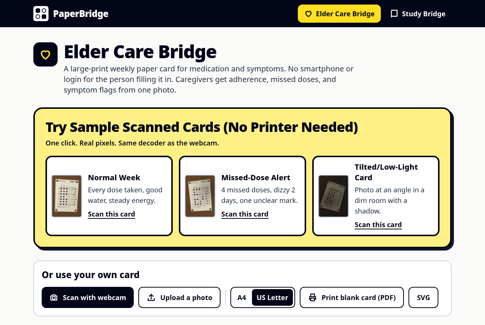
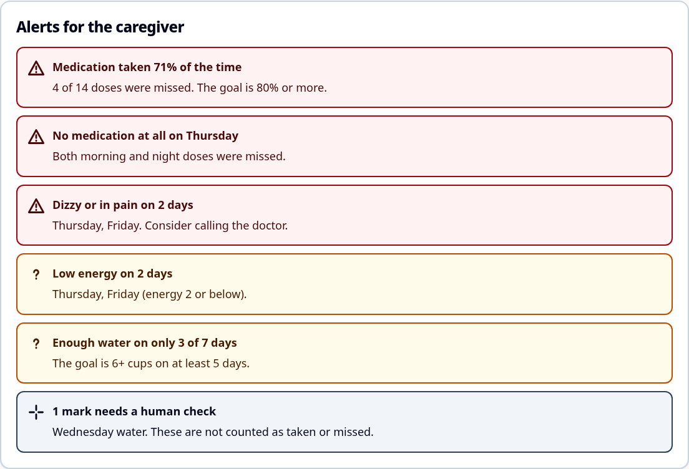
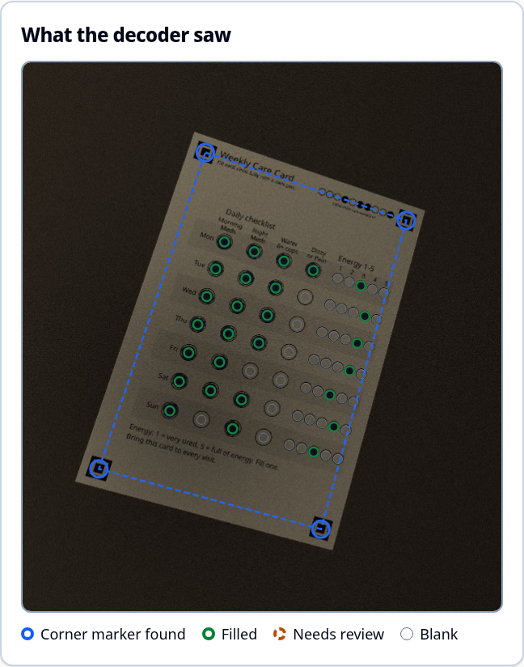
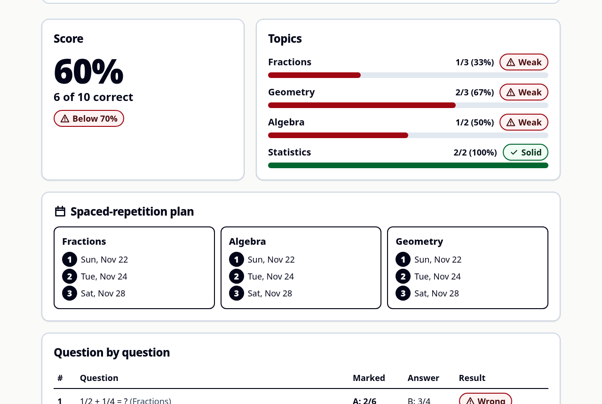

# paperbridge
Optical paper-to-digital bridge powered by deterministic perspective unwarping and Kiro

**PaperBridge** brings back the 1960s bubble sheet. You print a card, someone fills it in
with a pen, and one photo turns it into structured data. There is no smartphone, login, or
cloud upload for the person holding the pen, and no AI guessing at the marks: the card is
read with corner markers, a perspective transform, and local thresholds. The same image
always gives the same answer.

One reusable optical core powers two different apps, and a Kiro Crew App brings the alerts
into Kiro Crew. It installs as an offline app, and `npm run create-app` scaffolds the next
paper app. Built for **Kiroween 2026: Skeleton Crew**.

**Live demo: [paperbridge-acvw.onrender.com](https://paperbridge-acvw.onrender.com/)**



| | |
|---|---|
| **Skeleton** | `src/core/`: card generator (SVG/PDF), optical decoder, webcam capture, simulated camera |
| **App 1** | [`src/apps/elder-care/`](src/apps/elder-care/): Elder Care Bridge, a weekly medication and symptom card with a caregiver dashboard |
| **App 2** | [`src/apps/study-bridge/`](src/apps/study-bridge/): Study Bridge, an offline 10-question quiz sheet with auto-grading and a class gradebook |
| **Kiro Crew App** | [`crew-app/`](crew-app/): caregiver alert inbox plus a `care-auditor` agent |
| **Offline PWA** | Installs from the browser and works with no network: scanning, printing, samples, history, CSV export |
| **Dev kit** | [`npm run create-app`](docs/BUILD-YOUR-OWN-APP.md) scaffolder and the [Layout Validator MCP server](mcp/) |

## Try it in 10 seconds (no printer needed)

Open the [live demo](https://paperbridge-acvw.onrender.com/), or run it locally:

```bash
npm install
npm run dev        # open the URL Vite prints
```

1. The yellow **Try Sample Scanned Cards (No Printer Needed)** panel is the first thing on the page.
2. Click **Missed-Dose Alert**. The app loads a photo of a filled-in card and decodes its pixels in your browser, using the same decoder as the webcam.
3. You get the caregiver dashboard, the decoder's view of the photo (corner markers, filled bubbles, one unclear mark), the decode time, and the raw JSON.
4. Switch to **Study Bridge** in the top bar and click **Sam: Needs Review**.

To use a real card: **Print blank card (PDF)**, choose A4 or US Letter, fill it in with a dark
pen, then **Scan with webcam** or **Upload a photo**.

## Featured apps

### Elder Care Bridge ([`src/apps/elder-care/`](src/apps/elder-care/))

A large-print **Weekly Care Card**. For each day from Monday to Sunday it has Morning Meds,
Night Meds, Water 6+ cups, Dizzy or Pain, and Energy 1-5. The person fills it in on paper.
At the end of the week a caregiver scans it and gets:

- adherence % (doses taken divided by doses with a clear mark)
- missed-dose alerts by day and time, including whole missed days
- symptom flags, low-energy days, and water days
- a **needs a human check** list: unclear marks are never counted as taken or missed




Sample cards: **Normal Week** (100%), **Missed-Dose Alert** (71%, Thursday fully missed,
one faint mark), and **Tilted/Low-Light Card** (17 degrees tilt, perspective, dim light, shadow).
After every scan the app dispatches a `paperbridge:scan-alert` event with aggregate data only.

Caregiver workflow:

- **Resolve unclear marks by hand:** click the amber circle on the photo (or use the list below it). The dashboard recalculates and shows **Manually verified (N)**. The decoder's output is never changed.
- **Customize Card:** print the patient's name, the week's dates, and real medication names ("Metformin 500mg - Morning") on the card. Only text changes, so every version decodes the same way.
- **Save Week to History:** a multi-week adherence trend and a one-click **Doctor Visit Summary** in plain text.
- **Copy for Kiro Crew:** the alert JSON, ready to paste into the Crew App.



### Study Bridge ([`src/apps/study-bridge/`](src/apps/study-bridge/))

A **zero-distraction quiz answer sheet** with 10 questions and options A-E, for practice
without a screen. One photo gives:

- score % and a question-by-question table showing what was marked and the correct answer
- a double mark counts as invalid and is scored wrong; an unclear mark is labelled for the teacher
- topics below 70% flagged as weak, with spaced-repetition review dates at +1, +3 and +7 days

Teacher workflow:

- **Edit Answer Key:** set the answer and topic for each question. The sheet on screen re-grades on save.
- **Class sheet:** enter a student's name or ID after each scan. The **Class Weak-Topic Breakdown** shows the share of students below 70% per topic.
- **Export CSV Gradebook:** Student, Score, %, Double-Marked, Blank, Unclear, Weak Topics. Opens cleanly in Excel and Sheets, and names starting with `=` can't run as formulas.



### Kiro Crew App (`crew-app/`)

**PaperBridge Care Monitor** is a caregiver inbox inside Kiro Crew.

- **Alert inbox:** collects scan alerts from Crew `notification` events, the
  `/api/notifications` log, same-window `paperbridge:scan-alert` events, or pasted JSON.
- **Sidebar badge:** `useNavBadge()` counts the alerts that still need review.
- **Draft Caregiver Check-In:** opens a draft chat with the `care-auditor` agent, which uses
  the `adherence-analysis` skill.
- **Cmd+K command:** **Audit latest PaperBridge care card** opens the same agent.
- **Demo alert:** **Load demo alert** lets you try it without a scan.

See [`crew-app/README.md`](crew-app/README.md) for install steps and permissions.

## Works offline (installable PWA)

PaperBridge is a Progressive Web App built with `vite-plugin-pwa`. The service worker
precaches the whole app on first visit (about 1.9 MB): the page, the PDF generator, and every
sample photo. After that it runs with no network.

- **Install:** use the browser's *Install app* / *Add to Home Screen*. It opens in its own window (`display: standalone`).
- **Offline:** scanning (webcam and upload), sample cards, manual review, printing PDFs, history, the Doctor Visit Summary, and CSV export all keep working. They never needed the network: everything runs in the browser and saved data stays in `localStorage`.
- **Status:** when the device is offline, the header shows *Offline mode: scanning & printing still work locally* (a polite status message, AAA contrast).

## Build your own paper app

```bash
npm run create-app clinic-intake "Clinic Intake"
npm test && npm run dev    # open #clinic-intake
```

This writes [`src/apps/clinic-intake/`](docs/BUILD-YOUR-OWN-APP.md) with the 3-file contract:
- `layout.ts`: the printed card.
- `interpret.ts`: a pure function from marks to a report.
- `App.tsx`: the page on `ScanWorkbench`.

It also writes a sample-photo recipe and a test suite: geometry invariants, a unique card-ID check, and a `fast-check` decode property. Then it renders the sample photo. The new app joins the top switcher on its own, with no other files to edit.

The [developer guide](docs/BUILD-YOUR-OWN-APP.md) explains the contract and the rules, and has a ready-to-paste Kiro prompt.

## Layout Validator MCP server

[`mcp/server.ts`](mcp/server.ts) is a local, read-only MCP server (stdio,
`@modelcontextprotocol/sdk`). [`.kiro/settings/mcp.json`](.kiro/settings/mcp.json) adds it to
Kiro as `paperbridge`, so Kiro can check a card before anyone prints it.

| Tool | Does |
|---|---|
| `validate_card_layout` | Takes a `CardLayout` (object or JSON string) and checks bubbles against the page margins, the 4 corner markers, the card-ID strip, each other, and for unique IDs. Returns pass/fail with one diagnostic per problem, e.g. *Bubbles answers/Q1/A and answers/Q1/B are 10 mm apart (centres); they need at least 12.1 mm and currently overlap.* |
| `list_registered_apps` | Lists every app in `src/apps/`: label, card ID and version, page sizes, bubble groups, layout status, sample photos, and card-ID clashes. |

Run it by hand with `npm run mcp`.

## How Kiro built PaperBridge

### Spec-driven development
[`.kiro/specs/paperbridge/`](.kiro/specs/paperbridge/) holds EARS
[requirements](.kiro/specs/paperbridge/requirements.md), a
[design](.kiro/specs/paperbridge/design.md), and [tasks](.kiro/specs/paperbridge/tasks.md).
Each task group became one commit. Whenever the implementation changed course, we updated
the design doc to match. For example, the top-left corner is chosen by the direction of the
card's top edge (no orientation notch needed), and the Crew `ui.entry` path is relative to `ui/`.

### Conditional steering
| File | Scope | Enforces |
|---|---|---|
| [`product.md`](.kiro/steering/product.md) | always | No smartphone, login, or upload for the end user; a 1-click sample fallback on every UI |
| [`optical-geometry.md`](.kiro/steering/optical-geometry.md) | `src/core/**` | Pure, deterministic decoder; one shared layout object; the 5 decoding invariants |
| [`apps-ui.md`](.kiro/steering/apps-ui.md) | `src/apps/**` | Import only the public core API; shared scan workbench; 18px text, AAA contrast for Elder Care, never colour alone |

### Three agent hooks and an MCP server
| Hook | Trigger | Runs |
|---|---|---|
| [`core-tests-on-save`](.kiro/hooks/core-tests-on-save.json) | save `src/core/**/*.ts` | `npm test`: property tests prove the decoding invariants still hold |
| [`regen-samples-on-layout`](.kiro/hooks/regen-samples-on-layout.json) | save `src/apps/**/layout.ts` | `npm run gen:samples`: sample photos always match the printed card; fails if one stops decoding |
| [`typecheck-on-app-save`](.kiro/hooks/typecheck-on-app-save.json) | save `src/apps/**/*.ts(x)` | `npm run typecheck` |

The [Layout Validator MCP server](#layout-validator-mcp-server) gives Kiro a tool to check card geometry while it edits a `layout.ts`.

### Real bugs the tests caught
Property-based tests (`fast-check`) render random cards through a simulated camera and decode
them. They found these bugs before any human saw a wrong answer:

| Found by | Bug | Fix |
|---|---|---|
| fast-check P1 (scale 0.63, brightness 0.5) | At low resolution, the corner marker's ring and centre square drifted about 1 px apart, so the marker was rejected | Wider concentric tolerance; take the centre from the solid square |
| fast-check P1 (scale 0.5, perspective 8%) | 12 small card-ID bubbles misread at low resolution, giving a false `CARD_ID_MISMATCH` | 10 larger ID bubbles read with one midpoint threshold |
| fast-check P1 (strong perspective) | The **test generator** pushed card corners out of frame | The frame grows with perspective strength |
| Sample bubble-by-bubble test | The "faint" mark meant to show "needs review" decoded as blank (fill 0.175) | Mark recalibrated to 0.29, mid-band |
| Crew bundle smoke test | Two React copies (the UI package installed `react`), so hooks crashed | Types only in `crew-app/ui`; React comes from the host |
| Keyboard audit | The skip link set `#main`, which switched Study Bridge back to Elder Care | Move focus without changing the hash |

The tests also caught a mistake in our own expectations: we expected Sam's quiz to score
50%, but the decoder correctly read 6 of 10 (60%). The test was fixed, not the decoder.

## Core optical capabilities and verified guarantees

| Capability | Guarantee | Verified by |
|---|---|---|
| Rotation | Exact decode for any tilt in ±30° | fast-check P1, P2 (25 runs per `npm test`; 400-run soak passed) |
| Scale | Exact decode from 0.5x to 2x (1 to 4 px/mm) | P1, P2 |
| Perspective | Exact decode with up to 8% keystone per axis | P1 |
| Shadows and uneven light | Gradients up to 45%, shadow blobs up to 40%, brightness down to 50% | P1, P3 |
| Noise and compression | Sensor noise σ ≤ 5; JPEG q84 sample photos decode bubble for bubble | P1, sample tests |
| Missing corner marker | Returns `FIDUCIALS_NOT_FOUND`, never guessed data | P4 |
| Wrong card | Returns `CARD_ID_MISMATCH` via a 10-bit ID strip | P6 |
| Unclear marks | Reported as `ambiguous` with confidence ≤ 0.5, never coerced | edge-case test, Missed-Dose sample |
| Determinism | Same pixels give identical JSON; no AI, network, clock, or randomness | P5 |
| Paper sizes | A4 and US Letter | P7, layout tests |
| Speed | 1280x720 webcam frame: median **28.5 ms** (budget 500 ms) in Node; 54-99 ms per sample photo in headless Chromium | perf test |
| Accessibility | axe-core: 0 violations (WCAG 2.2 AA), AAA contrast on Elder Care, all text ≥ 18px, keyboard and screen-reader pass | manual audit with Playwright |
| Card geometry | Bubbles inside margins, clear of corner markers and the ID strip, at least 1.1 x (r1 + r2) apart, unique IDs | `checkLayout` tests, MCP tool, generated app tests |
| Custom cards | Customized labels, names and dates leave every bubble, marker and ID bit unchanged; a photographed custom card decodes with the default layout | card-settings tests |
| Offline | Shell, PDF chunk and all sample photos precached; full flow verified with the network off | service-worker check in headless Chromium |

## Spec a 3rd paper app with Kiro

`npm run create-app` gives you a working starter. To plan a bigger app first, paste this into Kiro as a new spec:

```markdown
# Spec: Community Feedback Card (src/apps/community-feedback/)

Reuse src/core and src/shell exactly as Elder Care Bridge and Study Bridge do.

## Requirements (EARS)
1. THE app SHALL print a one-page Community Feedback Card (A4 and Letter) with 6 statements
   (e.g. "The park feels safe", "Bus service is reliable") and a 1-5 agreement scale, plus
   a "Want a call back?" Yes/No row.
2. THE app SHALL offer a 1-click "Try Sample Scanned Cards (No Printer Needed)" panel with
   3 sample photos generated by `npm run gen:samples` and decoded from pixels at runtime.
3. WHEN a card is scanned, THE app SHALL show the score for each statement and flag any
   statement scored 1-2 as a concern.
4. IF a row has more than one mark, THEN THE app SHALL mark it invalid and exclude it.
5. WHEN a bubble is ambiguous, THE app SHALL show "needs review" and SHALL NOT count it.
6. WHEN several cards are scanned, THE app SHALL show the running average per statement,
   stored only in this browser.

## Design
- Start with: npm run create-app community-feedback "Community Feedback".
- layout.ts: one group, rows = statements, cols = "1".."5"; one group for call-back Yes/No.
  labelScale 1.3, bands for row tracking. Must pass validate_card_layout for A4 and Letter.
- interpret.ts: pure (scan) => FeedbackReport; unit tested.
- samples/specs.ts: 3 SampleSpecs (happy, mixed, tilted at night) in SAMPLE_SET.
- App.tsx: ScanWorkbench with renderResult + announce; appMeta registers it in the switcher.

## Tasks
- [ ] layout + generated layout tests pass
- [ ] interpret.ts + unit tests (invalid rows, ambiguous, concerns)
- [ ] sample specs, gen:samples, bubble-by-bubble sample test
- [ ] results UI
```

The steering files and hooks apply to the new folder automatically. Saving `layout.ts`
regenerates the sample photos, and saving any app file typechecks it.

## Project layout

```
src/core/              optical skeleton: layout, validate, render (SVG/PDF), decode, capture, testing/synth
src/shell/             shared UI: ScanWorkbench, app registry, overrides, storage, offline badge
src/apps/elder-care/   layout, interpret, card settings, history, CareDashboard
src/apps/study-bridge/ layout, answer key, grade, class sheet + CSV, StudyResults
scripts/               gen-samples.ts, create-app.mjs, gen-icons.ts
mcp/                   Layout Validator MCP server (validate_card_layout, list_registered_apps)
crew-app/              Kiro Crew App: app.json, agent, skill, ui (committed dist/index.mjs)
public/                PWA icons
docs/                  BUILD-YOUR-OWN-APP.md, screenshots
.kiro/                 specs, steering, hooks, settings/mcp.json
```

## Scripts

| Command | What it does |
|---|---|
| `npm run dev` | Start the app |
| `npm test` | 149 tests: property tests, end-to-end sample decodes, interpreters, overrides, history, CSV, layout validator, scaffolder, MCP tools, Crew App contract and bundle |
| `npm run typecheck` | `tsc --noEmit` |
| `npm run build` | Production build plus service worker and `manifest.webmanifest` (pdf-lib loads only when printing) |
| `npm run gen:samples` | Regenerate every app's sample photos (deterministic, byte-identical) |
| `npm run create-app <slug> "<Name>"` | Scaffold a new paper app ([guide](docs/BUILD-YOUR-OWN-APP.md)) |
| `npm run mcp` | Start the Layout Validator MCP server on stdio |
| `cd crew-app/ui && npm install && npm run build` | Rebuild the Crew page bundle |

Stack: React 19, TypeScript, Vite, Tailwind CSS v4, Vitest, fast-check, pdf-lib, vite-plugin-pwa.
Dev-only: @resvg/resvg-js and jpeg-js (sample generation), @modelcontextprotocol/sdk and zod (MCP server).

## License

MIT, see [LICENSE](LICENSE).
