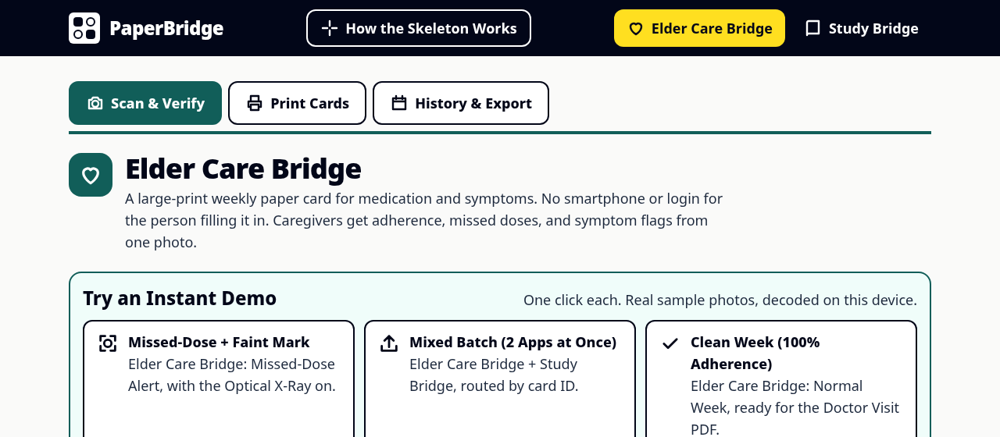
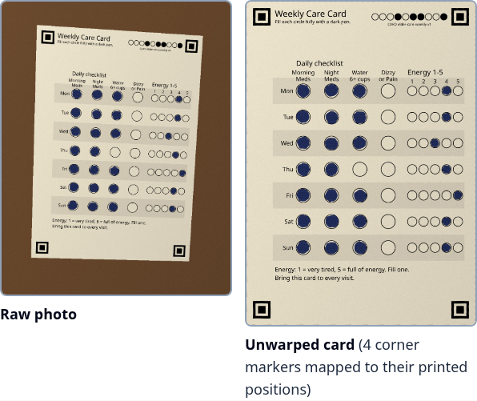
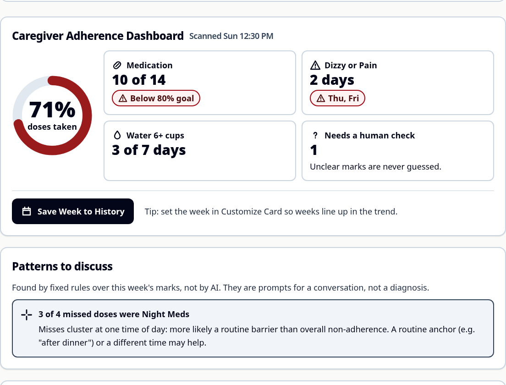
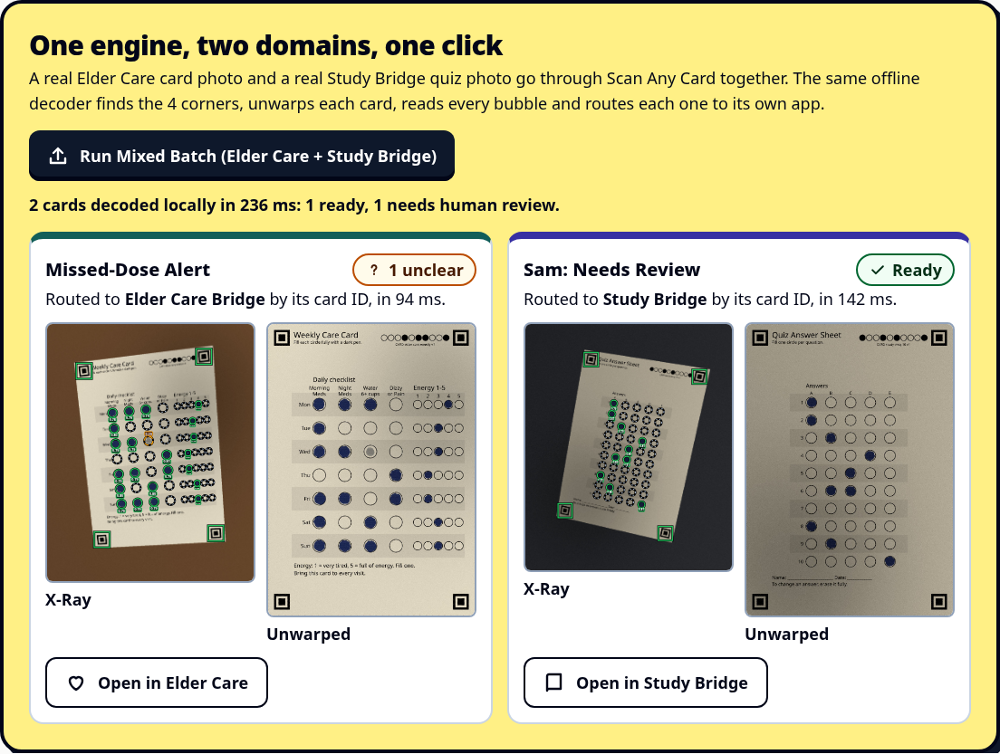

# PaperBridge

**Resurrecting reliable paper forms as an offline-first optical UI skeleton - zero AI guessing.**

Print a card, fill it in with a pen, take one photo. One shared optical engine reads it on your device with corner
markers and a perspective unwarp, sends anything unclear to a person, and powers two very different apps plus a
Kiro Crew App. Built for **Kiroween 2026: Skeleton Crew**.

<!-- Demo video row, hidden until the video is uploaded. Paste it back into the table below the Live demo row:
| **Demo video** | [Watch on YouTube](https://www.youtube.com/watch?v=VIDEO_ID) |
-->
| | |
|---|---|
| **Live demo** | [paperbridge-acvw.onrender.com](https://paperbridge-acvw.onrender.com/) (opens on Skeleton Home; works offline after the first visit) |
| **Kiro Crew App repo** | [meenanoolu/paperbridge-care-monitor](https://github.com/meenanoolu/paperbridge-care-monitor) (also in [`crew-app/`](crew-app/)) |
| **Blog post** | [Building PaperBridge: An Offline-First Optical UI Skeleton for Elder Care with Kiro](https://dev.to/meena_n/building-paperbridge-an-offline-first-optical-ui-skeleton-for-elder-care-with-kiro-1h76) (DEV) |
| **Social post** | [PaperBridge on X](https://x.com/MNoolu34434/status/2124436517087248756) |

<table>
  <tr>
    <td width="33%"></td>
    <td width="33%"></td>
    <td width="33%"></td>
  </tr>
  <tr>
    <td><b>1-click Instant Demo</b>: a faint mark, a 2-app batch, a clean week</td>
    <td><b>Optical X-Ray</b>: exactly what the decoder measured</td>
    <td><b>Raw vs. Unwarped</b>: the perspective correction, visible</td>
  </tr>
</table>

### Try it in 60 seconds (no printer needed)

1. Open the [live demo](https://paperbridge-acvw.onrender.com/). It lands on **Skeleton Home**. Click **Run Mixed Batch (Elder Care + Study Bridge)**: a real care-card photo and a real quiz photo are unwarped, X-Rayed and routed to their own apps, side by side.
2. Click **Open in Elder Care**. The card opens with the Optical X-Ray on and one amber mark sent for a human check. Click it to resolve it, then **Print Adapted Next-Week Card**.
3. Open **Print Cards** in either app: **Translate card** (తెలుగు, हिन्दी, Español), High-Visibility and Icon-Anchored modes, and a 4-sheet pack, from the same shared controls.
4. Use the top-right tabs to switch between **Skeleton Home**, **Elder Care** and **Study Bridge**, or click **How the Skeleton Works**.

> **Not medical advice.** Elder Care Bridge helps people track doses and symptoms on paper and talk to their care team. It does not diagnose or recommend treatment.

## Built with Kiro

| Kiro feature | Where | What it does here |
|---|---|---|
| **Spec-driven development** | [`.kiro/specs/paperbridge/`](.kiro/specs/paperbridge/) | EARS [requirements](.kiro/specs/paperbridge/requirements.md) R1-R46, [design](.kiro/specs/paperbridge/design.md) decisions with measured numbers, and [tasks](.kiro/specs/paperbridge/tasks.md) 1-22, one task group per commit |
| **Steering** | [`.kiro/steering/`](.kiro/steering/) | Always-on product rules, a `src/core/**` rule for the deterministic decoder, a `src/apps/**` rule for accessible thin apps |
| **Agent hooks** | [`.kiro/hooks/`](.kiro/hooks/) | 5 hooks of 3 kinds: tests, sample regeneration and typecheck on save; a `PreToolUse` guard on the protected decoder; a `Stop` check for core boundaries and WCAG |
| **MCP server** | [`mcp/`](mcp/) | Layout Validator: `validate_card_layout` and `list_registered_apps`, so Kiro checks a card before anyone prints it |
| **Scaffolder** | [`scripts/create-app.mjs`](scripts/create-app.mjs) | `npm run create-app` writes App #3 that already routes, batch-saves, reads aloud, prints in 4 languages and passes its own tests |
| **Kiro Crew App** | [`crew-app/`](crew-app/) | Caregiver inbox, sidebar badge, Cmd+K command, and a `care-auditor` agent that writes bilingual check-ins |

## Featured applications

Two different domains on the same [`src/core/`](src/core/) + [`src/shell/`](src/shell/) skeleton. Each app is a layout, an interpreter and a page.

<table>
  <tr>
    <th width="50%"><a href="src/apps/elder-care/">Elder Care Bridge</a> (clinical teal)</th>
    <th width="50%"><a href="src/apps/study-bridge/">Study Bridge</a> (academic indigo)</th>
  </tr>
  <tr>
    <td>A large-print weekly medication and symptom card. <b>Outcome: one photo gives a caregiver adherence %, missed doses, symptom-to-miss patterns and a 1-page Doctor Visit PDF, with no smartphone for the patient.</b></td>
    <td>A screen-free 10-question answer sheet. <b>Outcome: one photo gives a score, weak topics with 1/3/7-day review dates, a class weak-topic breakdown and a CSV gradebook.</b></td>
  </tr>
  <tr>
    <td></td>
    <td></td>
  </tr>
</table>



## Built once in the skeleton, inherited by every app

Elder Care Bridge, Study Bridge and any app from `npm run create-app` get all of this from `src/core/` and `src/shell/`:

| Capability | App code needed |
|---|---|
| Scan Any Card auto-route and batch save, 3-tab workspace, offline PWA | 0 (batch save: 1 line) |
| Optical X-Ray, Raw vs. Unwarped, 3-step decode pipeline, Test Decoder Resilience | 0 |
| Webcam with a 4-corner alignment guide and an offline lock-on chime | 0 |
| Read Aloud and Copy Quick Update | 1 function each |
| Print Cards: Translate card (English, Telugu, Hindi, Spanish, any script), High-Visibility, Icon-Anchored, multi-sheet packs | a translation table |
| Adaptive next card (Elder Care's adapted week, Study Bridge's due review sheet) | 1 function |

Text outside Latin-1 is drawn by the browser with its own fonts and embedded in the PDF inside the box the layout
check measured, so no fonts are bundled and English PDFs stay byte-identical.

### How it differs from classroom OMR tools
Bubble-sheet graders such as ZipGrade and OMRChecker are built to grade answer sheets. PaperBridge is
a reusable skeleton for any paper workflow: apps define their own cards and meanings, everything runs
offline in the browser with no account or upload, and unclear marks go to a person instead of being guessed.

## Run it locally

```bash
npm install
npm run dev                                       # opens on Skeleton Home
npm test                                          # 342 tests, including a 50-photo A4/Letter matrix
npm run create-app clinic-intake "Clinic Intake"  # App #3, ready to scan
```

## More detail

- [docs/DETAILS.md](docs/DETAILS.md): every feature, the Kiro Crew App, offline use, the MCP server, verified guarantees, real bugs the tests caught, project layout and scripts.
- [docs/BUILD-YOUR-OWN-APP.md](docs/BUILD-YOUR-OWN-APP.md): the 3-file contract, the slots, and a ready-to-paste Kiro prompt.
- [crew-app/README.md](crew-app/README.md): installing the Kiro Crew App.

## License

MIT, see [LICENSE](LICENSE).
