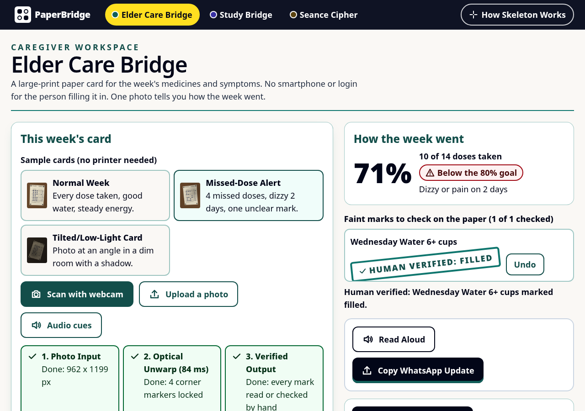

# PaperBridge

**Resurrecting reliable paper forms as an offline-first optical UI skeleton - zero AI guessing.**

Print a card, fill it in with a pen, take one photo. One shared optical engine reads it on your device with corner
markers and a perspective unwarp, sends anything unclear to a person, and powers three very different full-screen
apps plus a Kiro Crew App. Built for **Kiroween 2026: Skeleton Crew**.

<!-- Demo video row, hidden until the video is uploaded. Paste it back into the table below the Live demo row:
| **Demo video** | [Watch on YouTube](https://www.youtube.com/watch?v=VIDEO_ID) |
-->
| | |
|---|---|
| **Live demo** | [paperbridge-acvw.onrender.com](https://paperbridge-acvw.onrender.com/) (opens on Skeleton Home; works offline after the first visit) |
| **Kiro Crew App repo** | [meenanoolu/paperbridge-care-monitor](https://github.com/meenanoolu/paperbridge-care-monitor) (also in [`crew-app/`](crew-app/)) |
| **Blog post** | [Building PaperBridge: An Offline-First Optical UI Skeleton for Elder Care with Kiro](https://dev.to/meena_n/building-paperbridge-an-offline-first-optical-ui-skeleton-for-elder-care-with-kiro-1h76) (DEV) |
| **Social post** | [PaperBridge on X](https://x.com/MNoolu34434/status/2124436517087248756) |

## One skeleton, three frontends

A slim launcher bar (the PaperBridge mark, one pill per app, **How Skeleton Works**) opens each app full screen.
All three are built from the same `src/core/` engine and the same `src/shell/` primitives, and each looks nothing like the others.

<table>
  <tr>
    <th width="33%"><a href="src/apps/elder-care/">Elder Care Bridge</a><br>Warm Clinical Stationery</th>
    <th width="33%"><a href="src/apps/study-bridge/">Study Bridge</a><br>Live Classroom Studio</th>
    <th width="33%"><a href="src/apps/seance-cipher/">Seance Cipher</a><br>Obsidian and brass</th>
  </tr>
  <tr>
    <td></td>
    <td></td>
    <td></td>
  </tr>
  <tr>
    <td>Ivory and teal, AAA contrast. Two columns: card, X-Ray and Raw vs. Unwarped on the left; adherence, a 1-click <b>Human Verified</b> stamp, Read Aloud, WhatsApp update, Doctor Visit PDF and icon cards in 4 languages on the right. Presets sit in an accordion.</td>
    <td>Slate, indigo and emerald with <code>tabular-nums</code> telemetry. Live Scan, Print Studio and Gradebook tabs: topic-mastery bars, a batch gradebook, the Due Review Card and a multi-week quiz pack in Telugu and Hindi.</td>
    <td>Serif headings, a laser scan sweep and a glowing emerald and amber X-Ray. The Oracle Cipher card has 3 questions of 4 runes; decoding reveals a story verdict, plays a harmonic chord (with audio cues on) and offers the next chapter to print.</td>
  </tr>
</table>

### Try it in 60 seconds (no printer needed)

1. Open the [live demo](https://paperbridge-acvw.onrender.com/). On **Skeleton Home**, click **Run Mixed-Domain Auto-Route Demo**: one real card from each app is unwarped, X-Rayed and routed to its own app.
2. Click **Seance Cipher** in the launcher, then the sample **The Smudged Seance**. One faint rune goes to you: press **Mark filled** and the spirits give their verdict.
3. Open **Elder Care Bridge**, load a sample and stamp the amber mark **Human Verified**, then print the adapted next-week card.
4. Open **Study Bridge**, scan a quiz, then **Print Studio** for the Telugu or Hindi sheet and the quiz pack.

> **Not medical advice.** Elder Care Bridge helps people track doses and symptoms on paper and talk to their care team. It does not diagnose or recommend treatment.

## Built with Kiro

| Kiro feature | Where | What it does here |
|---|---|---|
| **Spec-driven development** | [`.kiro/specs/paperbridge/`](.kiro/specs/paperbridge/) | EARS [requirements](.kiro/specs/paperbridge/requirements.md) R1-R50, [design](.kiro/specs/paperbridge/design.md) decisions with measured numbers, and [tasks](.kiro/specs/paperbridge/tasks.md) 1-23, one task group per commit |
| **Steering** | [`.kiro/steering/`](.kiro/steering/) | Always-on product rules, a `src/core/**` rule for the deterministic decoder, a `src/apps/**` rule for accessible thin apps |
| **Agent hooks** | [`.kiro/hooks/`](.kiro/hooks/) | 5 hooks of 3 kinds: tests, sample regeneration and typecheck on save; a `PreToolUse` guard on the protected decoder; a `Stop` check for core boundaries and WCAG |
| **MCP server** | [`mcp/`](mcp/) | Layout Validator: `validate_card_layout` and `list_registered_apps`, so Kiro checks a card before anyone prints it |
| **Scaffolder** | [`scripts/create-app.mjs`](scripts/create-app.mjs) | `npm run create-app` writes your next app that already routes, batch-saves, reads aloud, prints in 4 languages and passes its own tests |
| **Kiro Crew App** | [`crew-app/`](crew-app/) | Caregiver inbox, sidebar badge, Cmd+K command, and a `care-auditor` agent that writes bilingual check-ins |

## The shared primitives

Every frontend composes the same pieces from [`src/shell/optical.tsx`](src/shell/optical.tsx), driven by one
`useOpticalScan` hook. Apps only choose layout and colours.

| Primitive | What it gives every app |
|---|---|
| `OpticalViewfinder` | Samples, webcam with a 4-corner alignment frame and lock-on chime, photo upload, audio cues |
| `OpticalXRayOverlay` | Lock-on boxes and ink scores on the photo, Raw vs. Unwarped, a themeable palette with optional glow |
| `BatchDropzone` | Scan Any Card: auto-routes Elder Care, Study Bridge and Seance cards in one drop, then batch-saves |
| `HumanVerifyControl` | Mark filled, Mark blank, Undo, and an animated Human Verified stamp for each unclear mark |
| `PrintSheetButton` | PDF and SVG of any layout: translations, High-Visibility, Icon-Anchored, multi-sheet packs |

Read Aloud, the copyable update, the decode pipeline, the adaptive next card and Test Decoder Resilience come from the
same barrel. Text outside Latin-1 is drawn by the browser and embedded in the PDF, so no fonts are bundled.

### How it differs from classroom OMR tools
Bubble-sheet graders such as ZipGrade and OMRChecker are built to grade answer sheets. PaperBridge is
a reusable skeleton for any paper workflow: apps define their own cards and meanings, everything runs
offline in the browser with no account or upload, and unclear marks go to a person instead of being guessed.

## Run it locally

```bash
npm install
npm run dev                                       # opens on Skeleton Home
npm test                                          # 365 tests, including a 50-photo A4/Letter matrix
npm run create-app clinic-intake "Clinic Intake"  # your next app, ready to scan
```

## More detail

- [docs/DETAILS.md](docs/DETAILS.md): every feature, the Kiro Crew App, offline use, the MCP server, verified guarantees, real bugs the tests caught, project layout and scripts.
- [docs/BUILD-YOUR-OWN-APP.md](docs/BUILD-YOUR-OWN-APP.md): the 3-file contract, the primitives, and a ready-to-paste Kiro prompt.
- [crew-app/README.md](crew-app/README.md): installing the Kiro Crew App.

## License

MIT, see [LICENSE](LICENSE).
