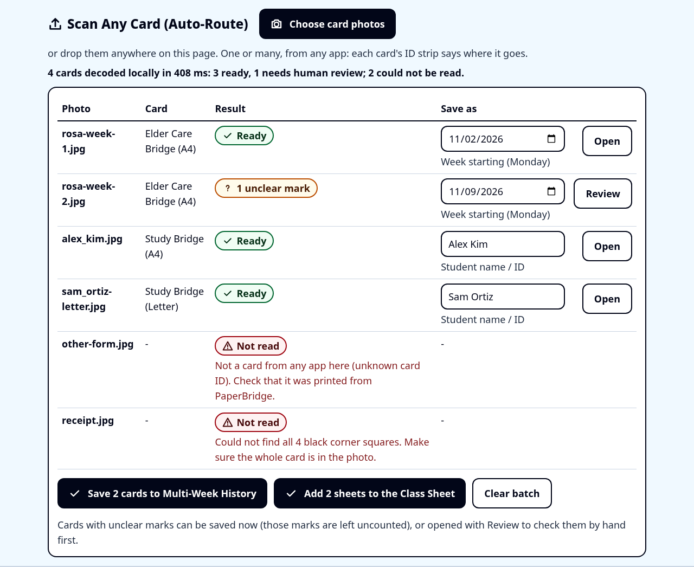
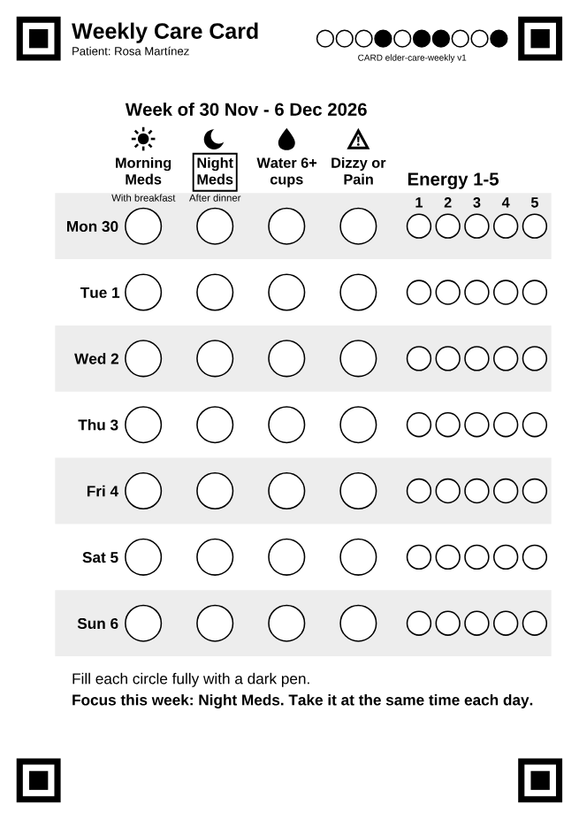
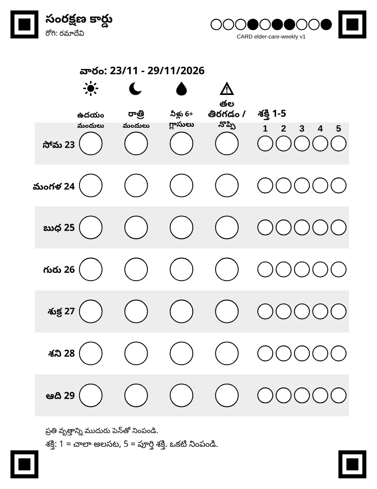
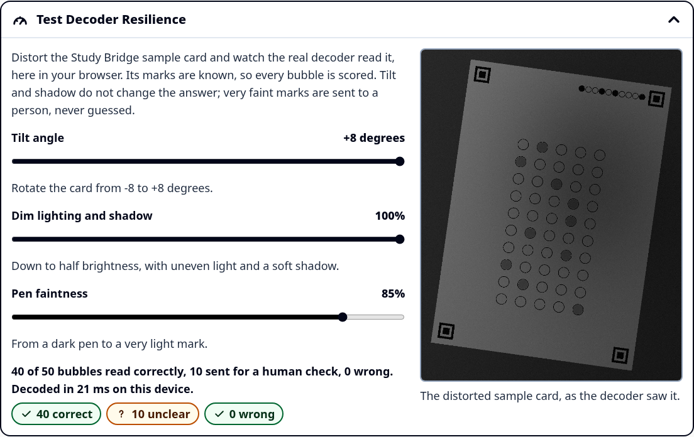
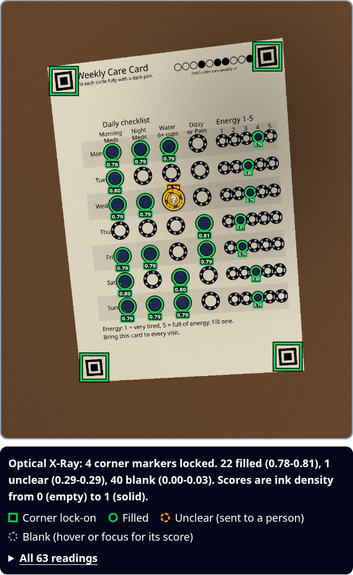
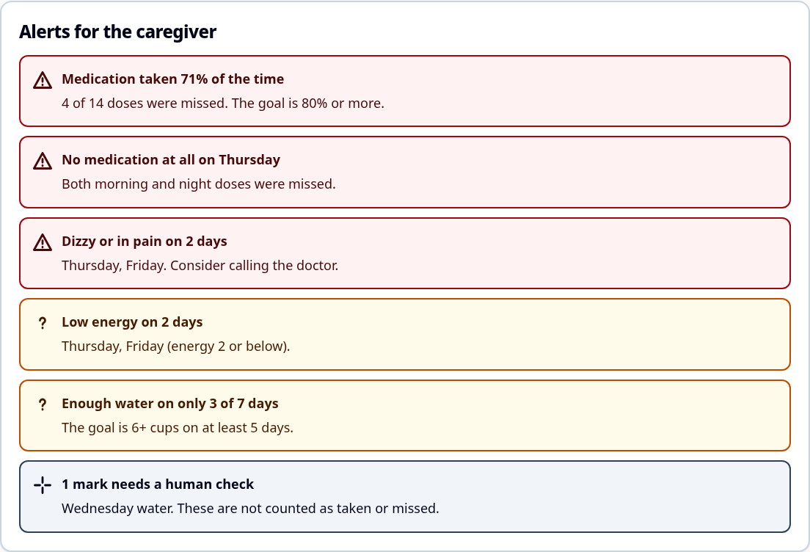
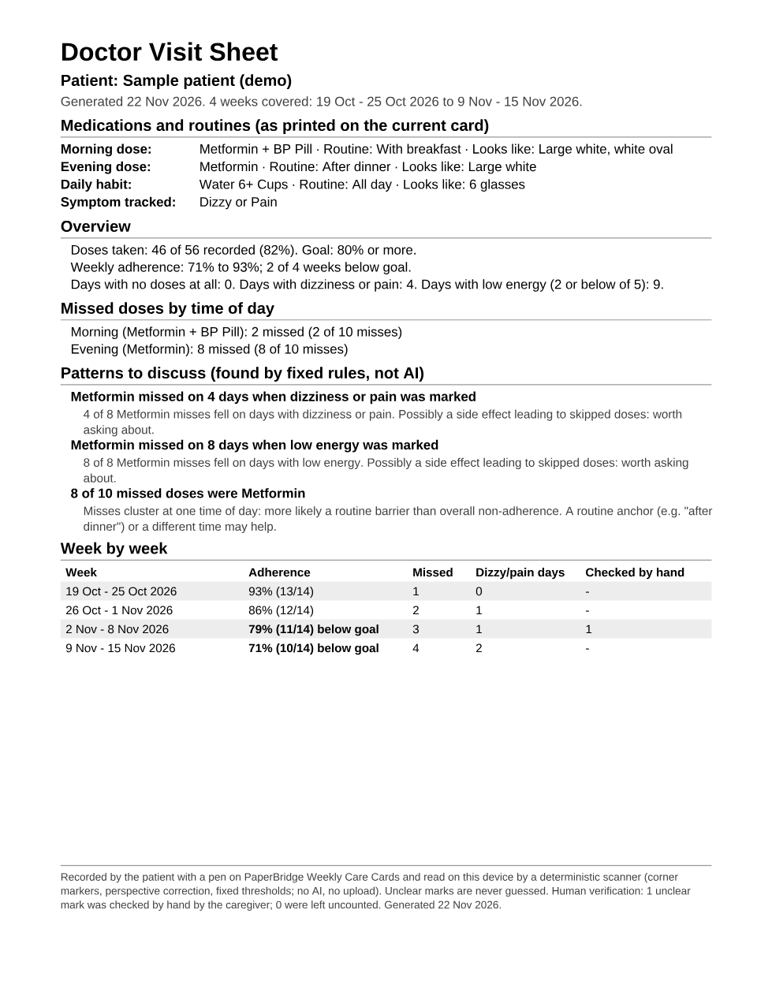
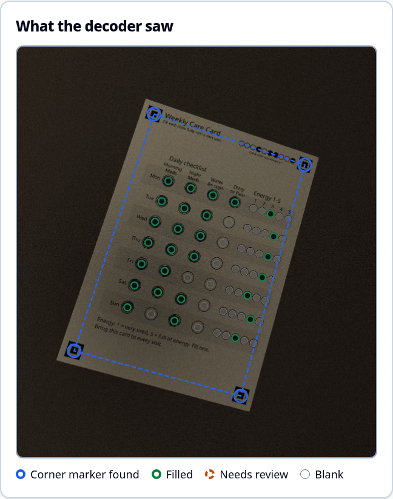

# PaperBridge: details

The [README](../README.md) is the 30-second tour. This page has the rest: how each part works,
what the tests guarantee, the bugs they caught, and the scripts. Developer guide:
[BUILD-YOUR-OWN-APP.md](BUILD-YOUR-OWN-APP.md).

## Run it locally


```bash
npm install
npm run dev        # open the URL Vite prints
```

Then follow the [60-second judge path](../README.md#try-it-in-60-seconds-no-printer-needed).

To use a real card: on **Print Cards**, choose A4 or US Letter and **Download 1-Week Card (PDF)**,
fill it in with a dark pen, then on **Scan & Verify** use **Scan with webcam** or **Upload a photo**.

**Scan Any Card (Auto-Route)** at the top of Scan & Verify takes one photo or a whole stack of them
(file picker or drag-and-drop). Each card's printed ID picks its app. One photo opens straight in
that app; a batch shows a summary like "4 cards decoded locally in 118 ms: 3 ready, 1 needs human
review", lists every file with its app, gives each failed file its own error, and bulk-saves Elder
Care cards to the history, Study Bridge sheets to the class sheet and Seance readings to the Grimoire. Files with unclear marks get
a **Review** button.



## Paper that adapts: the closed loop

PaperBridge is not only a scanner. What it reads shapes the next sheet of paper, still decoded the same way:

- **Print Adapted Next-Week Card (Elder Care):** when the fixed pattern rules find something, next Monday's card prints with a bold focus note in the footer ("Focus this week: Night Meds. Take it at the same time each day." or, for a symptom pattern, "Ask the doctor if dizziness or pain continues.") and the dose column boxed, or double-underlined when a box would touch the next label.
- **Print Due Review Card (Study Bridge):** after a sheet with weak topics, the review sheet's header names the topics and its footer lists the 1, 3 and 7-day review dates.
- **Translate card:** built-in offline packs for English, Telugu (తెలుగు), Hindi (हिन्दी) and Spanish translate the printed title, instructions, day names, default columns and routine anchors. With any non-English choice, caregivers can type labels in any script. Text outside Latin-1 is drawn by the browser with its own fonts and embedded as a PNG inside the exact box the layout check measured, so no fonts are bundled and English PDFs stay byte-identical. The dashboard and Doctor Visit PDF stay in English.
- **Icon-Anchored Print Mode:** a sun, moon, water drop and warning sign above the columns, drawn as vector paths in the core, for readers who rely on pictures more than words.

Every adapted, translated or icon card keeps every circle, corner marker and card-ID bit of the standard card, passes the Layout Validator on A4 and Letter, and decodes bubble for bubble the same (tested).

| Adapted next-week card | Telugu card with icons |
|---|---|
|  |  |

The Telugu sample was printed from Chromium with Noto Sans Telugu loaded, standing in for the system fonts of a phone or PC.

### Test Decoder Resilience

A collapsed drawer on Scan & Verify. Three sliders (tilt -8 to +8 degrees, dim lighting and shadow, pen faintness) distort a sample card with known marks, and the real decoder reads it in your browser, showing the decode time and how many bubbles were correct, sent for a human check, or wrong. Across the whole range nothing is read wrong: faint marks turn unclear.



## Built once in the skeleton, inherited by every app

These live in `src/shell/` and work for Elder Care Bridge, Study Bridge, Seance Cipher and any app from `npm run create-app`, with little or no app code:

- **Launcher bar and full-screen frontends:** a slim sticky bar with the PaperBridge mark (back to Skeleton Home), one pill per app and **How Skeleton Works**. An app that sets `appMeta.fullBleed` gets the whole page below it and builds its own layout from the primitives in `src/shell/optical.tsx` (`OpticalViewfinder`, `OpticalXRayOverlay`, `BatchDropzone`, `HumanVerifyControl`, `PrintSheetButton`), all driven by the `useOpticalScan` hook that `ScanWorkbench` also uses.
- **Human Verified stamp:** `HumanVerifyControl` gives each unclear mark Mark filled, Mark blank and Undo buttons and stamps the answer (the animation respects reduced motion). Each app passes its own colours.

- **Optical X-Ray** (Scan & Verify and the Stress-Test Lab): green lock-on boxes on the 4 corner markers, and a ring on every bubble coded by colour and dash (filled, unclear, blank) with the ink density the decoder measured, e.g. `0.79`, `0.29`, `0.02`. It only displays the existing decode result: no decoder code changed. A readings list gives the same data to keyboard and screen-reader users. **0 app code.**
- **Audio cues:** a short chime, synthesised offline with the Web Audio API, when the webcam locks onto all 4 corners. A toggle turns it off. **0 app code.**
- **Read Aloud** and **Copy Quick Update:** an app returns `spokenSummary` and/or `shareText` for a scan, and the shell adds the buttons, the offline `speechSynthesis` voice choice and the copy confirmation. Elder Care reads the week in the card's language (English, Telugu, Hindi or Spanish) and copies a 4-line family update; Study Bridge reads the score and copies a 3-line update with the review dates.
- **Try an Instant Demo:** 3 one-click scenarios built from what apps declare in `appMeta.demo`: a faint mark with the X-Ray on, a mixed 2-app batch through Scan Any Card, and a clean week. **1 line per app.**
- **3-step decode pipeline:** Photo Input, Optical Unwarp (with the real decode time), Verified Output, with "needs review" until every unclear mark is checked. **0 app code.**
- **Raw vs. Unwarped:** the photo next to the card redrawn flat from the same 4 corner correspondences the decoder uses (display only). **0 app code.**
- **Accents and X-Ray palettes:** `appMeta.accent` colours the launcher pill dot, app badge and primary buttons. The X-Ray takes a palette, with an optional glow (Seance Cipher uses emerald and amber).
- **Print Cards workspace:** Translate card (English, Telugu, Hindi, Spanish, any script), any-script PDF text, High-Visibility and Icon-Anchored modes, the card download and a multi-sheet pack. An app passes a `print` slot; `createPrintSlot` builds one from a translation table. Elder Care uses it for the 4-Week Monthly Pack, Study Bridge for the 4-Week Unit Quiz Pack and its Telugu, Hindi and Spanish sheets.
- **Adaptive next card:** an app returns an `adaptiveCard` spec for a scan, and the shell renders it with one component: Elder Care's Print Adapted Next-Week Card and Study Bridge's Print Due Review Card.
- **Skeleton Home:** the default landing view, a full-viewport midnight blueprint stage with 3 world portal cards (Elder Care Bridge, Study Bridge, Seance Cipher), each drawn in its app's own theme. **Run Mixed-Domain Auto-Route Demo** sends one real card from each app through Scan Any Card and shows each card's X-Ray, its unwarped view and the app it was routed to; **Scaffold Your Next App** opens the architecture dialog with `npm run create-app`.
- **Saving without storage code:** a generic saved-cards list in `localStorage` with a ready Scan Any Card batch adapter. Scaffolded apps use it by default.



## App details

### Elder Care Bridge ([`src/apps/elder-care/`](../src/apps/elder-care/))

A large-print **Weekly Care Card**. For each day from Monday to Sunday it has Morning Meds,
Night Meds, Water 6+ cups, Dizzy or Pain, and Energy 1-5. The person fills it in on paper.
At the end of the week a caregiver scans it and gets:

- adherence % (doses taken divided by doses with a clear mark)
- missed-dose alerts by day and time, including whole missed days
- symptom flags, low-energy days, and water days
- a **needs a human check** list: unclear marks are never counted as taken or missed



Sample cards: **Normal Week** (100%), **Missed-Dose Alert** (71%, Thursday fully missed,
one faint mark), and **Tilted/Low-Light Card** (17 degrees tilt, perspective, dim light, shadow).
After every scan the app dispatches a `paperbridge:scan-alert` event with aggregate data only.

Caregiver workflow:

- **Resolve unclear marks by hand:** click the amber circle on the photo (or use the list below it). The dashboard recalculates and shows **Manually verified (N)**. The decoder's output is never changed.
- **Customize Card:** print the patient's name, the week's dates, and real medication names ("Metformin 500mg - Morning") on the card. Only text changes, so every version decodes the same way.
- **Routine anchors and pill cues:** print "With breakfast" or "White oval" under each column, so the card matches the person's routine. Only text changes, so the card decodes the same way.
- **Symptom-to-miss patterns:** fixed rules, not AI, flag doses missed on days with dizziness, pain or low energy, and misses that cluster at one time of day. They are worded as questions to ask, never as a diagnosis.
- **High-Visibility Print Mode:** bold text, larger day labels and light row bands for low vision. The bubbles don't move, and faint marks on shaded rows are still flagged for a human check.
- **Doctor Visit PDF:** a one-page sheet made on the device, offline: medications and routines, adherence by week, missed doses by time of day, patterns, and how many marks were checked by hand.
- **Regimen presets:** BP & Diabetes, Post-Surgery Recovery, or Simple Morning & Night fill the columns, routine anchors and pill cues in one click. Everything stays editable.
- **Download 4-Week Pack (1 Month):** one 4-page PDF, Week 1 to Week 4 from the chosen Monday, with the same names, cues and High-Visibility setting on every page.
- **Save Week to History:** a multi-week adherence trend and a one-click **Doctor Visit Summary** in plain text.
- **Load 4-Week Sample History:** with no saved weeks yet, load a demo patient (93% to 71% over 4 weeks, one hand-checked mark) to see the trend, patterns, summary and Doctor Visit PDF. **Clear History** removes it.
- **Copy for Kiro Crew:** the alert JSON, ready to paste into the Crew App.





### Study Bridge ([`src/apps/study-bridge/`](../src/apps/study-bridge/))

A **zero-distraction quiz answer sheet** with 10 questions and options A-E, for practice
without a screen. One photo gives:

- score % and a question-by-question table showing what was marked and the correct answer
- a double mark counts as invalid and is scored wrong; an unclear mark is labelled for the teacher
- topics below 70% flagged as weak, with spaced-repetition review dates at +1, +3 and +7 days

Teacher workflow:

- **Edit Answer Key:** set the answer and topic for each question. The sheet on screen re-grades on save.
- **Class sheet:** enter a student's name or ID after each scan. The **Class Weak-Topic Breakdown** shows the share of students below 70% per topic.
- **Export CSV Gradebook:** Student, Score, %, Double-Marked, Blank, Unclear, Weak Topics. Opens cleanly in Excel and Sheets, and names starting with `=` can't run as formulas.

### Seance Cipher: X-Ray Rite ([`src/apps/seance-cipher/`](../src/apps/seance-cipher/))

An endless survival arcade on a printed sheet. **The 12-Rune Sheet** has 12 blank white circles in 3 rows of 4. Each circle is named above (`1 Skull` to `12 Star`) and its rune is drawn below as a vector picture, so nothing but a finger or token ever touches a circle. It keeps the Oracle Cipher card's exact 12 bubble coordinates, corner markers and card ID, so photos of either print decode the same way and the two bundled sample photos still route here.

**The game** (`riteEngine.ts`, pure and unit tested):

| Rule | Value |
|---|---|
| States | `menu`, `waveIntro` (1.5 s announcement), `active`, `gameOver` |
| Lives | 3. A missed wave costs one, breaks the combo and moves on to the next wave |
| Wave timer | `max(1800, 4200 - 180 x wave)` ms |
| Targets | 1 rune for waves 1 to 3, 2 for 4 to 6, 3 for 7 to 9, 4 from wave 10 |
| Banish | cover reading of `PERFECT = 0.48` or more. Pays `round(100 x (1 + 0.15 x combo))` |
| Trembling Hand | reading from `0.22` up to just under `0.48`. The timer drains at 60% speed (40% slower) while it lasts. The rune is cursed for the wave: its banish pays points but cannot grow the combo, and no banish grows it while another target is cursed |
| Wave clear | bonus of 1 point per 10 ms left on the timer |
| Camera loses the sheet | the timer waits, so a hidden card never costs a life |

**Two ways to play** (`RiteGame.tsx`):

- **Live optical webcam.** `riteCamera.ts` decodes a frame every 100 ms with the same optical decoder. The first frames try A4 and Letter and keep the paper whose printed rings line up (`decodeBestFit`); after that one decode per frame. The cover of a rune is the decoder's own ink density `fill` inside its bubble. A two-frame noise guard (the lower of the last two readings) stops one bad frame from banishing a rune. The overlay pulses targets in antique gold `#D4AF37`, flickers a crimson beam and dashed ring on a trembling target, and bursts emerald on a banish. The timer, the camera stream and the video are released on stop and on unmount.
- **Instant digital launchpad.** The 12 runes as a 3 x 4 grid of buttons. Hold a pad (mouse, touch, Space or Enter) or its key (`1-9`, `0`, `-`, `=`) for 250 ms or more and it reads `1.0` (a full banish); a quick tap reads `0.35` (a trembling hand). Judges without a printer can play at once.

Web Audio chords (no audio files): a major triad that climbs a semitone per combo step on a banish, a beating buzz on a tremble, a falling third when a life is lost and a low minor chord at Game Over. **Game Over** shows the frozen Optical X-Ray (the last camera frame, or the sheet on the launchpad, with the runes still standing marked in dashed crimson), the final wave, score and max combo, **Play Again** (focus moves there) and **Copy Score Receipt**. The best score is kept on the device.

Real numbers from the simulated camera on the printed sheet: nothing on a circle reads 0.00; a dark token 0.94; a dark fingertip 0.78; a dark fingertip over 60% of the circle 0.53; a mid skin tone 0.45; a pale skin tone 0.30; a dark fingertip half off the circle 0.38. So the 0.48 line is met by a dark token or a pressed dark fingertip, while a pale fingertip in bright light lands in the Trembling Hand range. Real webcams are not verified.

The original 3-question **Oracle Cipher** card is kept in a collapsed section: the same 12 circles and card ID, story verdicts, the faint-mark human check, and the landing place for a card routed here from Skeleton Home. The obsidian `#0B0D12` and brass `#D4AF37` theme passes WCAG 2.2 AA.

### Kiro Crew App (`crew-app/`)

**PaperBridge Care Monitor** is a caregiver inbox inside Kiro Crew. It also lives in its own repo,
[meenanoolu/paperbridge-care-monitor](https://github.com/meenanoolu/paperbridge-care-monitor), so it can be installed on its own.

Alerts arrive by copy and paste: click **Copy for Kiro Crew** in Elder Care Bridge, then
**Paste alert JSON** in the Crew page (or click **Load demo alert**). PaperBridge never uploads anything.

- **Alert inbox:** validates and stores pasted alerts. It also accepts alerts from Crew `notification` events and the `/api/notifications` log (for a Crew automation that posts them), and same-window `paperbridge:scan-alert` events.
- **Sidebar badge:** `useNavBadge()` counts the alerts that still need review.
- **Draft Caregiver Check-In:** opens a draft chat with the `care-auditor` agent, which uses
  the `adherence-analysis` skill and turns each pattern into a gentle question.
- **Bilingual check-ins:** translated cards send `cardLanguage` (e.g. `te-IN`). The page shows a
  **Card: Telugu** badge, and `care-auditor` writes a **Clinical Note (English)** for the doctor or
  pharmacist and a **Gentle Check-In Opener** in the patient's language (Telugu, Hindi or Spanish).
- **Cmd+K command:** **Audit latest PaperBridge care card** opens the same agent.
- **Demo alert:** **Load demo alert** lets you try it without a scan (its card is in Telugu, so the check-in is bilingual).

See [`crew-app/README.md`](../crew-app/README.md) for install steps and permissions.

## Works offline (installable PWA)

PaperBridge is a Progressive Web App built with `vite-plugin-pwa`. The service worker
precaches the whole app on first visit (about 1.9 MB): the page, the PDF generator, and every
sample photo. After that it runs with no network.

- **Install:** use the browser's *Install app* / *Add to Home Screen*. It opens in its own window (`display: standalone`).
- **Offline:** scanning (webcam and upload), sample cards, manual review, printing PDFs, history, the Doctor Visit Summary and PDF, the 4-Week Pack, and CSV export all keep working. They never needed the network: everything runs in the browser and saved data stays in `localStorage`.
- **Status:** when the device is offline, the header shows *Offline mode: scanning & printing still work locally* (a polite status message, AAA contrast).

## Build your own paper app

```bash
npm run create-app clinic-intake "Clinic Intake"
npm test && npm run dev    # open #clinic-intake
```

This writes [`src/apps/clinic-intake/`](BUILD-YOUR-OWN-APP.md) with the 3-file contract:
- `layout.ts`: the printed card.
- `interpret.ts`: a pure function from marks to a report.
- `App.tsx`: the page on `ScanWorkbench`.

It also writes a sample-photo recipe and a test suite: geometry invariants, a unique card-ID check, and a `fast-check` decode property. Then it renders the sample photo. The new app joins the top switcher on its own, with no other files to edit, and already has Scan Any Card auto-routing and batch save, a Saved Cards tab, Read Aloud, Copy Quick Update, Audio cues and the Optical X-Ray (a test scaffolds one in a temp folder and checks typecheck, its tests, routing and batch save).

The [developer guide](BUILD-YOUR-OWN-APP.md) explains the contract and the rules, and has a ready-to-paste Kiro prompt.

## Layout Validator MCP server

[`mcp/server.ts`](../mcp/server.ts) is a local, read-only MCP server (stdio,
`@modelcontextprotocol/sdk`). [`.kiro/settings/mcp.json`](../.kiro/settings/mcp.json) adds it to
Kiro as `paperbridge`, so Kiro can check a card before anyone prints it.

| Tool | Does |
|---|---|
| `validate_card_layout` | Takes a `CardLayout` (object or JSON string) and checks bubbles against the page margins, the 4 corner markers, the card-ID strip, each other, and for unique IDs. Returns pass/fail with one diagnostic per problem, e.g. *Bubbles answers/Q1/A and answers/Q1/B are 10 mm apart (centres); they need at least 12.1 mm and currently overlap.* |
| `list_registered_apps` | Lists every app in `src/apps/`: label, card ID and version, page sizes, bubble groups, layout status, sample photos, and card-ID clashes. |

Run it by hand with `npm run mcp`.

## How Kiro built PaperBridge

### Spec-driven development
[`.kiro/specs/paperbridge/`](../.kiro/specs/paperbridge/) holds EARS
[requirements](../.kiro/specs/paperbridge/requirements.md), a
[design](../.kiro/specs/paperbridge/design.md), and [tasks](../.kiro/specs/paperbridge/tasks.md).
Each task group became one commit. Whenever the implementation changed course, we updated
the design doc to match. For example, the top-left corner is chosen by the direction of the
card's top edge (no orientation notch needed), and the Crew `ui.entry` path is relative to `ui/`.

### Conditional steering
| File | Scope | Enforces |
|---|---|---|
| [`product.md`](../.kiro/steering/product.md) | always | No smartphone, login, or upload for the end user; a 1-click sample fallback on every UI |
| [`optical-geometry.md`](../.kiro/steering/optical-geometry.md) | `src/core/**` | Pure, deterministic decoder; one shared layout object; the 5 decoding invariants |
| [`apps-ui.md`](../.kiro/steering/apps-ui.md) | `src/apps/**` | Import only the public core API; shared scan workbench; 18px text, AAA contrast for Elder Care, never colour alone |

### Five agent hooks of three kinds, and an MCP server
| Hook | Trigger | Runs |
|---|---|---|
| [`core-tests-on-save`](../.kiro/hooks/core-tests-on-save.json) | save `src/core/**/*.ts` | `npm test`: property tests prove the decoding invariants still hold |
| [`regen-samples-on-layout`](../.kiro/hooks/regen-samples-on-layout.json) | save `src/apps/**/layout.ts` | `npm run gen:samples`: sample photos always match the printed card; fails if one stops decoding |
| [`typecheck-on-app-save`](../.kiro/hooks/typecheck-on-app-save.json) | save `src/apps/**/*.ts(x)` | `npm run typecheck` |
| [`protect-core-pre-tool`](../.kiro/hooks/protect-core-pre-tool.json) | `PreToolUse` on write and shell tools | [`protect-core.mjs`](../scripts/hooks/protect-core.mjs): asks the person before any write to `src/core/decode/`, `layout.ts` or `capture/`, and tells the agent to run the 50-photo A4/Letter matrix ([`paper-matrix.test.ts`](../src/shell/__tests__/paper-matrix.test.ts)) and the property tests first |
| [`verify-boundaries-on-stop`](../.kiro/hooks/verify-boundaries-on-stop.json) | `Stop` (agent ends its turn) | [`verify-boundaries.mjs`](../scripts/hooks/verify-boundaries.mjs): keeps the agent working if `src/core` imports `src/apps` or `src/shell`; if UI files changed, asks once for the axe-core WCAG 2.2 AA / AAA check |

The [Layout Validator MCP server](#layout-validator-mcp-server) gives Kiro a tool to check card geometry while it edits a `layout.ts`.

### Real bugs the tests caught
Property-based tests (`fast-check`) render random cards through a simulated camera and decode
them. They found these bugs before any human saw a wrong answer:

| Found by | Bug | Fix |
|---|---|---|
| fast-check P1 (scale 0.63, brightness 0.5) | At low resolution, the corner marker's ring and centre square drifted about 1 px apart, so the marker was rejected | Wider concentric tolerance; take the centre from the solid square |
| fast-check P1 (scale 0.5, perspective 8%) | 12 small card-ID bubbles misread at low resolution, giving a false `CARD_ID_MISMATCH` | 10 larger ID bubbles read with one midpoint threshold |
| fast-check P1 (strong perspective) | The **test generator** pushed card corners out of frame | The frame grows with perspective strength |
| Sample bubble-by-bubble test | The "faint" mark meant to show "needs review" decoded as blank (fill 0.175) | Mark recalibrated to 0.29, mid-band |
| Crew bundle smoke test | Two React copies (the UI package installed `react`), so hooks crashed | Types only in `crew-app/ui`; React comes from the host |
| Batch test across paper sizes (5 samples x 5 cameras x 2 papers) | Every scan path tried A4 first and accepted it, so **Letter prints were read with A4 bubble positions**: 1 to 7 extra unclear marks, sometimes different readings | Decode every paper size and keep the best fit (fewest unclear marks, then highest confidence): 50 of 50 correct |
| Keyboard audit | The skip link set `#main`, which switched Study Bridge back to Elder Care | Move focus without changing the hash |
| Bundle size check on X-Ray Rite | Importing `pdf-lib` at the top of the sheet module pulled it into the first load (454 KB to 915 KB) | Import it on demand inside `riteSheetPdf`, like the core's PDF code: 495 KB, `pdf-lib` lazy again |
| Real-browser look at a lit pad | The pulse faded the whole button, so the rune name dropped below AA contrast at the dim point | Pulse a separate glow ring; the button never fades |
| axe-core on the launchpad | `label-content-name-mismatch` on all 12 pads: the aria-label did not contain the visible "1 Skull" | No aria-label; the visible words are the name |
| Screenshot of a lit Moon pad | The crescent's cut-out was painted in the pad colour and showed as a dark disc over the gold beam | Draw each rune through an SVG mask, so cut-outs are real holes |
| Keyboard audit on the print panel | The page's yellow focus ring vanished on parchment | Parchment panels set a dark ring for their controls |
| Unit test of the Trembling Hand | A 0.3 reading put on a rune that happened to be a target slowed the timer, so "time ran out" never fired | Test readings go on a rune that is not lit (the engine is right: a tremble slows the timer) |
| Seance sample x 7 cameras x 2 papers | An A4 smudged Seance card read with the Letter layout showed 0 unclear marks (misplaced samples landed on blank paper), so "fewest unclear" picked the wrong paper | Score how dark each bubble's printed ring is through the homography and prefer the paper whose rings line up; on 98 photos the printed paper always wins, by at least 0.835 |

The tests also caught a mistake in our own expectations: we expected Sam's quiz to score
50%, but the decoder correctly read 6 of 10 (60%). The test was fixed, not the decoder.

## Core optical capabilities and verified guarantees

| Capability | Guarantee | Verified by |
|---|---|---|
| Rotation | Exact decode for any tilt in ±30° | fast-check P1, P2 (25 runs per `npm test`; 400-run soak passed) |
| Scale | Exact decode from 0.5x to 2x (1 to 4 px/mm) | P1, P2 |
| Perspective | Exact decode with up to 8% keystone per axis | P1 |
| Shadows and uneven light | Gradients up to 45%, shadow blobs up to 40%, brightness down to 50% | P1, P3 |
| Noise and compression | Sensor noise σ ≤ 5; JPEG q84 sample photos decode bubble for bubble | P1, sample tests |
| Missing corner marker | Returns `FIDUCIALS_NOT_FOUND`, never guessed data | P4 |
| Wrong card | Returns `CARD_ID_MISMATCH` via a 10-bit ID strip | P6 |
| Unclear marks | Reported as `ambiguous` with confidence ≤ 0.5, never coerced | edge-case test, Missed-Dose sample |
| Determinism | Same pixels give identical JSON; no AI, network, clock, or randomness | P5 |
| Paper sizes | A4 and US Letter | P7, layout tests |
| Speed | 1280x720 webcam frame: median **28.5 ms** (budget 500 ms) in Node; 54-99 ms per sample photo in headless Chromium | perf test |
| Accessibility | axe-core: 0 violations (WCAG 2.2 AA), AAA contrast on Elder Care, all text ≥ 18px, keyboard and screen-reader pass | manual audit with Playwright |
| Card geometry | Bubbles inside margins, clear of corner markers and the ID strip, at least 1.1 x (r1 + r2) apart, unique IDs | `checkLayout` tests, MCP tool, generated app tests |
| Custom cards | Customized labels, names and dates leave every bubble, marker and ID bit unchanged; a photographed custom card decodes with the default layout | card-settings tests |
| Offline | Shell, PDF chunk and all sample photos precached; full flow verified with the network off | service-worker check in headless Chromium |

## Spec a 3rd paper app with Kiro

`npm run create-app` gives you a working starter. To plan a bigger app first, paste this into Kiro as a new spec:

```markdown
# Spec: Community Feedback Card (src/apps/community-feedback/)

Reuse src/core and src/shell exactly as Elder Care Bridge and Study Bridge do.

## Requirements (EARS)
1. THE app SHALL print a one-page Community Feedback Card (A4 and Letter) with 6 statements
   (e.g. "The park feels safe", "Bus service is reliable") and a 1-5 agreement scale, plus
   a "Want a call back?" Yes/No row.
2. THE app SHALL offer a 1-click "Try Sample Scanned Cards (No Printer Needed)" panel with
   3 sample photos generated by `npm run gen:samples` and decoded from pixels at runtime.
3. WHEN a card is scanned, THE app SHALL show the score for each statement and flag any
   statement scored 1-2 as a concern.
4. IF a row has more than one mark, THEN THE app SHALL mark it invalid and exclude it.
5. WHEN a bubble is ambiguous, THE app SHALL show "needs review" and SHALL NOT count it.
6. WHEN several cards are scanned, THE app SHALL show the running average per statement,
   stored only in this browser.

## Design
- Start with: npm run create-app community-feedback "Community Feedback".
- layout.ts: one group, rows = statements, cols = "1".."5"; one group for call-back Yes/No.
  labelScale 1.3, bands for row tracking. Must pass validate_card_layout for A4 and Letter.
- interpret.ts: pure (scan) => FeedbackReport; unit tested.
- samples/specs.ts: 3 SampleSpecs (happy, mixed, tilted at night) in SAMPLE_SET.
- App.tsx: ScanWorkbench with renderResult + announce; appMeta registers it in the switcher.

## Tasks
- [ ] layout + generated layout tests pass
- [ ] interpret.ts + unit tests (invalid rows, ambiguous, concerns)
- [ ] sample specs, gen:samples, bubble-by-bubble sample test
- [ ] results UI
```

The steering files and hooks apply to the new folder automatically. Saving `layout.ts`
regenerates the sample photos, and saving any app file typechecks it.

## Project layout

```
src/core/              optical skeleton: layout, validate (geometry + printed text), render (SVG/PDF, multi-page, vector icons, highlights), decode, capture, testing/synth
src/shell/             shared UI: launcher bar, optical primitives + useOpticalScan, ScanWorkbench with 3 tabs, Optical X-Ray, audio cues, Read Aloud / Copy Quick Update, generic saved cards, app registry, Scan Any Card routing + batch, stress lab, any-script text images, overrides, storage, offline badge
src/apps/elder-care/   layout, interpret, card settings (anchors, cues, High-Visibility, icons), i18n packs, adaptive card, presets, monthly pack,
                       patterns, history, sample history, Doctor Visit PDF, batch adapter, CareDashboard
src/apps/study-bridge/ layout, answer key, grade, class sheet + CSV, due review sheet, batch adapter, StudyResults, Studio (telemetry, topic mastery)
src/apps/seance-cipher/ layout (3 chapters + the 12-Rune Sheet), oracle (story verdicts), riteEngine (pure game), riteCamera, riteSheet + runeGlyphs, RiteGame/RitePads/RiteLive/RiteReceipt, riteAudio, theme, samples
src/__tests__/         integration tests: shipped app layouts against the core Layout Validator
scripts/               gen-samples.ts, create-app.mjs, gen-icons.ts, hooks/ (Kiro hook scripts)
mcp/                   Layout Validator MCP server (validate_card_layout, list_registered_apps)
crew-app/              Kiro Crew App: app.json, agent, skill, ui (committed dist/index.mjs); mirrored at meenanoolu/paperbridge-care-monitor
public/                PWA icons
docs/                  BUILD-YOUR-OWN-APP.md, screenshots
.kiro/                 specs, steering, hooks, settings/mcp.json
```

## Scripts

| Command | What it does |
|---|---|
| `npm run dev` | Start the app |
| `npm test` | 444 tests: property tests, end-to-end sample decodes, interpreters, overrides, history, CSV, layout validator, scaffolder, MCP tools, auto-routing and batch scan, 50-photo paper-size matrix, monthly pack, presets, adaptive cards, language packs and icons, stress lab, tabs, hooks, Optical X-Ray, audio and speech controls, generic batch save, Instant Demo scenarios, decode pipeline, Raw vs. Unwarped, accents and the architecture dialog, shared print and packs in every app, Skeleton Home and the launcher, Seance Cipher layout and verdicts, the X-Ray Rite engine, sheet, camera loop, audio and page, auto-route across 3 apps, frontend keyboard markup, Crew App contract, cardLanguage and bundle |
| `npm run typecheck` | `tsc --noEmit` |
| `npm run build` | Production build plus service worker and `manifest.webmanifest` (pdf-lib loads only when printing) |
| `npm run gen:samples` | Regenerate every app's sample photos (deterministic, byte-identical) |
| `npm run create-app <slug> "<Name>"` | Scaffold a new paper app ([guide](BUILD-YOUR-OWN-APP.md)) |
| `npm run mcp` | Start the Layout Validator MCP server on stdio |
| `cd crew-app/ui && npm install && npm run build` | Rebuild the Crew page bundle |

Stack: React 19, TypeScript, Vite, Tailwind CSS v4, Vitest, fast-check, pdf-lib, vite-plugin-pwa.
Dev-only: @resvg/resvg-js and jpeg-js (sample generation), @modelcontextprotocol/sdk and zod (MCP server).
